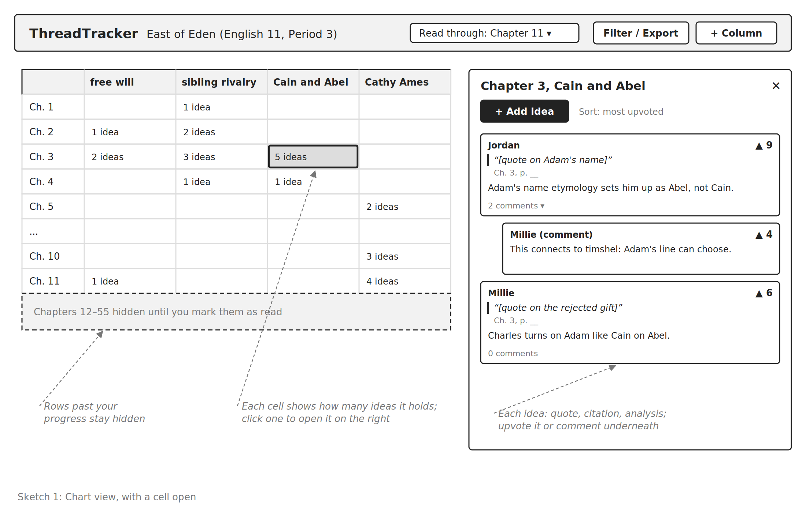
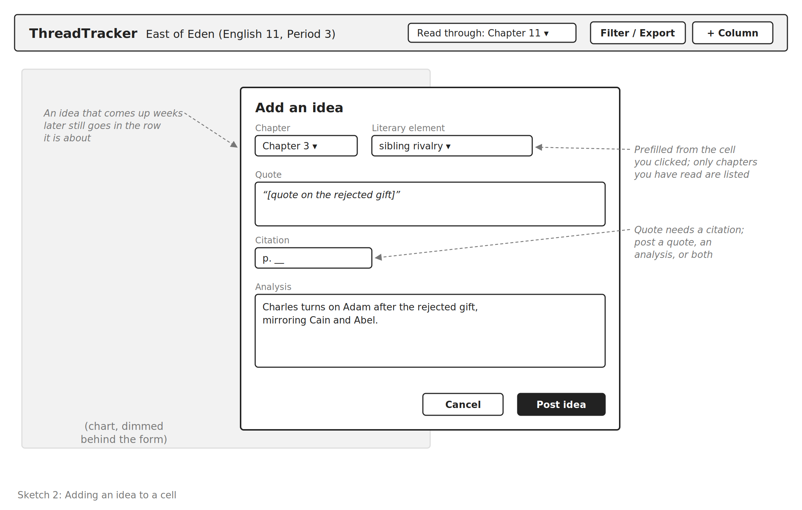
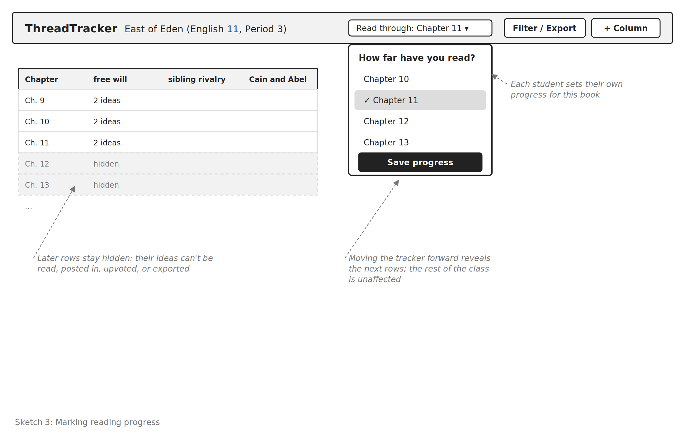
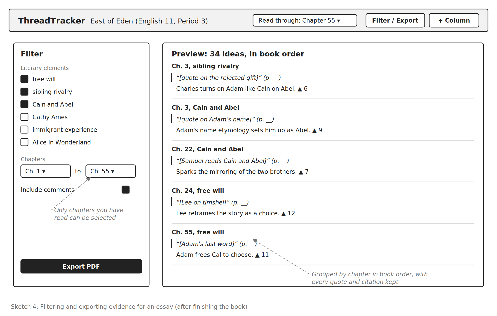

# Problem Framing

## Domain

In an English literature class, typically, the class reads a book, and engages in group activities and discussions about literary elements of the book, such as the historical context, characters, literary devices, and themes. This typically takes weeks and occurs in-class and over an online discussion board. The teacher, acting as a moderator, models skills such as analysis and guides interpretations that students would not reach on their own. Additionally, these group activities and discussions act as preparation for the student to write an essay.

Then students are tasked to write individual essays synthesizing and drawing on the group activities and discussions. These essays usually focus on one aspect of the book, but span multiple parts of the timeline. (For example, an essay on John Steinbeck's *East of Eden* could focus on the question of free will, but trace it through the beginning when Adam and Charles mirror Abel and Cain, to the middle when Lee connects "timshel" to "thou mayest," to the end when Adam's last word to Cal is timshel and frees Cal from the generational burden of him and Aron again mirroring Cain and Abel.)

For the student, through writing the essay, they find and deepen their own understanding. For the teacher, they see individual students' takeaways.

## Bad Situations

The discussions typically take weeks and include multiple different literary elements of the book, as books are multi-faceted and can be examined from multiple perspectives. This also primes different students to write about different literary elements of the book, which they are encouraged to do. Additionally, the discussions are not necessarily chronological, as later developments in a book can spark revisits to earlier events in the book.

Furthermore, students often take notes and try to document the discussions so they can use ideas from the discussions in their essay, but their notes are often in chronological order of the discussion, not the book or organized by aspect of the book. Sometimes discussions occur over an online discussion board, and the original text of the discussion itself is saved.

Then before they write their essay, students still need to process pages of notes. The processing usually entails consolidating ideas about the literary element of the book that they want to write about, and sorting them into chronological order of the book, not the discussion.

Worse, if students did not take good notes, they may miss some ideas from the discussions, need to frantically flip through the book to find them, or need to use a search engine or generative AI. But the ideas from frantically flipping through the book are often rushed and half-baked, and ideas from a search engine or generative AI are often generic.

For example, Millie's class may read and discuss John Steinbeck's *East of Eden* in four weeks, one part per week. The literary elements are diverse: the sibling rivalry between Adam and Charles and then Aron and Cal, Lee and Samuel Hamilton's immigrant experiences, and the allusion to Alice in Wonderland and its relation to Cathy. Additionally, later developments in a book can spark revisits to earlier events in the book, as Samuel Hamilton's reading of Abel and Cain sparks further discussion on Adam and Charles' sibling rivalry and mirroring of the story.

Millie takes notes, but they are only roughly organized by when ideas occurred in the discussion, not literary element or chronological order. The online discussion board saves the posts too, but they are paragraph-long posts from all 20 of her classmates. In the end, Millie chooses to write about the question of free will.

Before writing the essay, she spends an evening processing pages of notes and discussion board posts from all 20 of her classmates, pulling everything about free will out and sorting everything to be in chronological order of the book. She mostly succeeds, pulling out sufficient evidence and even moving the further discussion of Adam and Charles' sibling rivalry and mirroring of the story into the beginning, as Adam and Charles' sibling rivalry occurred in the beginning of the book. Unfortunately, one of her classmates made a good point about Adam's name etymology that she missed but would have tied into and significantly strengthened her essay. Additionally, she did not write down all of the exact quotes to discuss, so she finds some by first frantically flipping through the 600-page book before giving up and having generative AI generate the rest, potentially inaccurate, quotes. In general, her essay has strong moments and ideas but ill-fitting quotes.

Ultimately, the cost is borne not only by Millie, but by all of her classmates as they process their notes individually. Because each student writes an essay drawing on the same discussions, the students spend many hours redoing the same processing separately. The cost is also the missed ideas that the students collectively found and the teacher carefully guided the students to. Students who turn to a search engine or generative AI may get generic ideas and quotes that may not match the text at all or violate the AI policy of the class.

Other bad situations can include missing a class and that class session's ideas altogether, and being behind on the reading and wanting to catch up.

## Corroboration

A [master's thesis at Simon Fraser University (Marbouti, 2012)](https://summit.sfu.ca/item/12207) found that students in online discussions tend to read only new posts and reply only to the most recent ones, which hurts learning in several ways. This shows that students tend to engage only with the most recent part of a discussion. This matches the bad situation that earlier ideas are forgotten as discussion moves on, so students like Millie miss a classmate's good point about Adam's name etymology.

Furthermore, study guides recommend [theme trackers](https://www.notelyn.com/blog/theme-tracker), tables of a theme, its location, and a quote, and note that students use them for English essays, where specific textual evidence matters more than general summary. This source is a commercial blog, so this shows that some students do this but not how many, but this matches the bad situation that students must consolidate ideas by literary element before they write.

Readers at different points in a book also care about avoiding spoilers. Direct evidence from classrooms is limited, but in a similar setting, book clubs report choosing [Fable](https://shityoushouldcareabout.substack.com/p/how-to-join-our-book-club) specifically because its chapter-by-chapter threads keep discussion spoiler-free. This suggests that students who miss class or fall behind want to catch up without spoilers and still enjoy the book.

However, finding evidence is not the only difficulty students face in writing essays. One [AP Literature resource](https://www.varsitytutors.com/practice/subjects/ap-english-literature-and-composition/lessons/explain-evidence-and-reasoning-fiction-drama) observes that many students can find relevant quotations but struggle to explain how the evidence connects to their thesis. Thus, the bad situation described is one significant cost in essay writing but not the only one.

## Workarounds and Comparables

### Workarounds

The most common workaround is consolidating and re-sorting by hand, as discussed above in Bad Situations. This works, but takes time, especially as this is done typically individually, so each student repeats the same work. Additionally, only the ideas that the student initially wrote down are resurfaced.

Another workaround is initially taking the notes in a theme tracker, a table that records a theme and the chapter that it appears in. Although it lessens the later processing, the structure can be tedious to maintain, especially manually in a physical notebook or online document.

Another workaround is to search the notes (if electronic), discussion boards, and ebook with Ctrl+F, but this only searches by specific words, not ideas, and requires that the student remembers exact wording.

Of course, students may use search engines or generative AI, but they get generic ideas and quotes that may not match the text at all or violate the AI policy of the class.

### Comparables

Learning management system discussion boards, such as Canvas, Ed, and Piazza, are the default tool for online discussion boards. They save the entire original text, but sort it by chronological time and prompt. They are the source, not solution of the bad situation.

Social annotation tools, such as Perusall and Hypothesis, are the closest comparables. Students comment directly on the text, and in Perusall, students can tag comments with hashtags and search a tag to find all related comments. However, results are returned as a flat list rather than organized by the book's timeline, so students still have to sort them before writing.

Study guides, such as LitCharts and SparkNotes, organize quotes and analysis by chapter and theme, which shows an alternative structure for note-taking that is useful for essay-writing. However, they are written by experts and cannot be added to, so they do not include the class's own discussions, and each student who uses them draws on the same generic quotes.

Furthermore, chapter-gated discussion apps, such as Fable and BookTalk, separate discussion by chapter so that readers avoid spoilers. However, they are designed for book clubs rather than classes, and organize discussion only by chapter, so consolidating everything said about one theme still requires going through every chapter's discussion.

Thus, existing tools organize discussion either by time or by location in the text. The organization that essays require, by element of the book and then by the book's timeline, exists only in hand-built trackers, which are tedious to maintain, and in study guides, which do not include the class's discussion.

## Solution Sketch

Instead of organizing discussion by when it occurred, discussion could be organized by where it belongs in the book. For example, the class's discussion could be kept in a shared table, with the chapters of the book as rows and the literary elements the class discusses as columns. Each idea, with its quote and citation, would be placed in the cell for the chapter and literary element it is about, even if it came up weeks later in the discussion.

Thus, the processing that each student currently does individually before writing their essay would already be done by the class collectively during the discussions. A student writing about one literary element could read down its column and find every idea from the class about it, already in chronological order of the book and with accurate quotes. Additionally, since the table is organized by chapter, students who are absent or fall behind could catch up incrementally, reading only the rows up to where they have read, without spoilers.

## Stakeholder List

Students: they suffer the most cost, spending hours consolidating and re-sorting discussion ideas and usable ideas for an essay, while likely still losing good discussion ideas.

Students who are absent or fall behind: they want to catch up, but also want to do so incrementally and while avoiding spoilers.

Teachers: they lead the discussions, and want the students to draw on ideas from the discussions, not miss them entirely.

Graders (teachers or TAs): they read and grade the resulting essays, and want to see the ideas generated and learned from discussions, not generic outputs from a search engine or generative AI.

# Application Pitch

## Name

ThreadTracker

## Motivation

The problem is that between class discussions and individual essay-writing, each literature student must process pages of notes organized by discussion chronology, not book chronology or literary element, losing hours and many of the best ideas and quotes.

## Key Features

### Literary Element Chart

Each book has a chart with chapters as rows and literary elements as columns. Literary elements are chosen for each book and can be characters, themes, symbols, or historical context, such as "Cathy Ames," "imagery of the Salinas Valley," or "the value of money" for *East of Eden*. In each cell, students post ideas. Ideas can include a quote and its citation, and the student's analysis, and can be liked and commented on by other classmates.

Ideas are already organized by their location in the chronology of the book (row) and their literary element (column), not by when they were discussed. Students no longer need to spend significant amounts of time re-organizing and re-sorting notes or worry about missing points. Additionally, teachers can see the class's discussion in a structure that students use, and save it for their personal records or to prepare for future classes.

### Filtering and Exporting

Rows and columns can be filtered and exported as a PDF, so students can focus on the parts of the chart relevant to their essay. For example, a student writing about the connection between Cathy and Charles can filter to the columns "Cathy," "Charles," and "symbol: forehead scar" and export every idea, with quotes and citations, in the order of the book. Rather than spend hours re-organizing and re-sorting notes, students start their essay with their evidence in one place.

### Spoiler Prevention

Rows can be automatically hidden and students can unhide them as they read (by moving a tracker). Students who are behind can still read and post on what they have read, without having what they have not read spoiled, so they can still participate. Students who are ahead can post on what they are reading, and neither they nor the teacher need to worry that they are spoiling for the other students.

# Concept Design

## Concept Specifications

### Charting

**concept** Charting [User, Item]

**purpose** organize items by where they are in an ordered sequence (rows) and by which category they are in (columns)

**principle** an owner creates a chart with rows and columns; members add items to cells and can filter the chart to return items only in certain row(s) and column(s), in row order

**state**

- a set of Charts with
  - a title String
  - an owner User
  - a set of members User
  - a sequence of Rows with
    - a label String
  - a sequence of Columns with
    - a label String
  - a set of Placements with
    - an item Item
    - a row Row
    - a column Column

**actions**

- `createChart(title: String, owner: User, rowLabels: seq String, columnLabels: seq String): (chart: Chart)`
  - **then** create a chart with title as title, owner as owner, members as a set with just owner, one row per row label in order, and one column per column label in order
- `addMember(chart: Chart, user: User)`
  - **where** user is not a member of chart
  - **then** add user to the members of chart
- `addColumn(chart: Chart, label: String, user: User): (column: Column)`
  - **where** user is a member of chart; the columns of chart do not have a column with this label
  - **then** add a new column with this label to the end of the columns of chart
- `addItem(item: Item, chart: Chart, row: Row, column: Column, user: User)`
  - **where** row and column are in chart; user is a member of chart; item is not placed
  - **then** add a placement with item as item, row as row, column as column to the placements of chart
- `deleteItem(item: Item, chart: Chart)`
  - **where** item is in the placements of chart
  - **then** remove the placement of item from the placements of chart

**queries**

- `_filter(chart: Chart, rows?: set Row, columns?: set Column): (items: seq Item)`
  - **where** each row in rows and each column in columns is in chart
  - **returns** items in the given rows and columns, ordered by row position in chart; if rows or columns is omitted, all rows or all columns of chart are included
- `_rowIndex(row: Row, chart: Chart): (index: Number)`
  - **where** row is in chart
  - **returns** the position of row in the rows of chart, starting at 1
- `_rowCount(chart: Chart): (count: Number)`
  - **returns** the number of rows of chart
- `_itemIndex(item: Item, chart: Chart): (row: Row, column: Column)`
  - **where** item is in chart
  - **returns** the row and column that item is in
- `_isMember(chart: Chart, user: User): (result: Boolean)`
  - **returns** true if user is in the members of chart, and false otherwise

### Posting

**concept** Posting [User]

**purpose** let people contribute ideas and respond to the ideas of others

**principle** a user creates a post with a quote and its citation, an analysis, or both; others can read and comment; comments appear underneath the post

**state**

- a set of Posts with
  - an author User
  - an optional quote String
  - an optional citation String
  - an optional analysis String
  - an optional commentOn Post
  - a created DateTime

**actions**

- `create(author: User, quote?: String, citation?: String, analysis?: String): (post: Post)`
  - **where** quote and citation are both given or both omitted; at least one of quote or analysis is given
  - **then** create a new post
- `comment(author: User, quote?: String, citation?: String, analysis?: String, commentOn: Post): (post: Post)`
  - **where** commentOn is a post; quote and citation are both given or both omitted; at least one of quote or analysis is given
  - **then** create a new post with commentOn set to commentOn
- `edit(post: Post, author: User, quote?: String, citation?: String, analysis?: String)`
  - **where** author is the author of post; quote and citation are both given or both omitted; at least one of quote or analysis is given
  - **then** update the quote, citation, and analysis of post
- `delete(post: Post, author: User)`
  - **where** author is the author of post
  - **then** remove post and all comments linked to it, directly or indirectly

**queries**

- `_comments(post: Post): (comments: seq Post)`
  - **returns** the comments on post, oldest first

### Upvoting

**concept** Upvoting [User, Item]

**purpose** let people signal the most valuable items, so the most valuable items stand out

**principle** after a user upvotes an item, the count of the item increases by one; if they remove the upvote, the count of the item decreases by one; a user can upvote an item at most once

**state**

- a set of Upvotes with
  - a voter User
  - an item Item

**actions**

- `upvote(voter: User, item: Item)`
  - **where** there is not an upvote with voter and item
  - **then** add an upvote with voter and item
- `unvote(voter: User, item: Item)`
  - **where** there is an upvote with voter and item
  - **then** remove the upvote with voter and item

**queries**

- `_count(item: Item): (count: Number)`
  - **returns** the number of upvotes with item
- `_hasUpvoted(voter: User, item: Item): (result: Boolean)`
  - **returns** true if there is an upvote with voter and item, and false otherwise

### Progressing

**concept** Progressing [User, Context]

**purpose** track how far each user is, so later content can be withheld until they reach it

**principle** after a user marks that they have reached a step of a context, their progress in that context is that step until they update it; their progress in other contexts is unaffected

**state**

- a set of Progresses with
  - a user User
  - a context Context
  - a reached Number

**actions**

- `setProgress(user: User, context: Context, reached: Number)`
  - **where** reached is at least 0
  - **then** set the progress of user in context to reached

**queries**

- `_reached(user: User, context: Context): (reached: Number)`
  - **returns** the progress of user in context, or 0 if no progress is recorded for user and context

### Authenticating

**concept** Authenticating

**purpose** identify users so actions can be attributed to them

A standard username and password concept (register, login, logout), used without modification.

## Essential Reactions

### CreatePost

A user can only post in rows they have read, so they cannot spoil chapters they have not read.

**reaction** CreatePost

**when** `Request.createPost(user, chart, row, column, quote?, citation?, analysis?)`

**where**

- `Charting._isMember(chart, user)` is true
- `Charting._rowIndex(row, chart)` is at most `Progressing._reached(user, chart)`

**then**

- `Posting.create(author: user, quote, citation, analysis): (post)`
- `Charting.addItem(item: post, chart, row, column, user)`

### CreateComment

A user can only comment on posts in rows they have read in that chart.

**reaction** CreateComment

**when** `Request.comment(user, chart, commentOn, quote?, citation?, analysis?)`

**where**

- `Charting._isMember(chart, user)` is true
- `commentOn` is in chart
- `Charting._itemIndex(commentOn, chart)` returns `(row, column)`
- `Charting._rowIndex(row, chart)` is at most `Progressing._reached(user, chart)`

**then**

- `Posting.comment(author: user, quote, citation, analysis, commentOn): (comment)`
- `Charting.addItem(item: comment, chart, row, column, user)`

### UpdateProgress

A user marks how far they have read, which determines the rows that they can access.

**reaction** UpdateProgress

**when** `Request.setProgress(user, chart, reached)`

**where**

- `Charting._isMember(chart, user)` is true
- `reached` is at most `Charting._rowCount(chart)`

**then** `Progressing.setProgress(user, context: chart, reached)`

### ViewChart

Get the chart view, including filtered rows and columns and excluding rows that the user has not reached.

**reaction** ViewChart

**when** `Request.viewChart(user, chart, rows?, columns?)`

**where**

- `Charting._isMember(chart, user)` is true
- `visibleRows` is the set of rows `r` of chart (or of rows, if given) such that `Charting._rowIndex(r, chart)` is at most `Progressing._reached(user, chart)`
- `Charting._filter(chart, visibleRows, columns)` returns `items`

**then** respond with `items`

### ExportChart

Export the ViewChart.

**reaction** ExportChart

**when** `Request.export(user, chart, rows?, columns?)`

**where**

- `Charting._isMember(chart, user)` is true
- `visibleRows` and `items` are computed as in ViewChart

**then** respond with `items`, which the front end renders as a PDF

### UpvotePost

A user can only upvote in rows they have read.

**reaction** UpvotePost

**when** `Request.upvote(user, chart, post)`

**where**

- `Charting._isMember(chart, user)` is true
- `Charting._itemIndex(post, chart)` returns `(row, column)`
- `Charting._rowIndex(row, chart)` is at most `Progressing._reached(user, chart)`

**then** `Upvoting.upvote(voter: user, item: post)`

### DeletePost

When a post is deleted, it and its comments are also removed from the chart.

**reaction** DeletePost

**when** `Posting.delete(post, author)`

**where** `comments` is every post linked to post through commentOn, directly or indirectly

**then** `Charting.deleteItem(post, chart)` and `Charting.deleteItem(c, chart)` for each `c` in `comments`

## Concept Roles

**Authenticating** identifies each user, so that every post, comment, upvote, and progress update can be attributed to them. The User type in every other concept is bound to the users of Authenticating.

**Charting** is the core of the app. Each book read by a class is a chart, with chapters as rows and literary elements as columns. Charting also controls access: only members of a chart can view it, post in it, comment in it, upvote in it, or export it, and each reaction checks `Charting._isMember` before calling Posting, Upvoting, or Progressing. The Item type of Charting is bound to posts from Posting, including comments, which are placed in the same cell as the post they respond to. Charting never stores the content of a post, only which cell it is in.

**Posting** holds the content of ideas: a quote and its citation, an analysis, or both. Comments are posts with `commentOn` set, so posts and comments share one structure.

**Upvoting** lets members signal the strongest ideas in a cell. Its Item type is bound to posts from Posting, so both posts and comments can be upvoted.

**Progressing** prevents spoilers. Its Context type is bound to charts from Charting, so a user has separate progress for each book. Its `reached` number is compared to `Charting._rowIndex`: a user can only view, post, comment, upvote, or export in rows whose index is at most the progress of that user in that chart.

Filtering and exporting are not separate concepts. Both use `Charting._filter`, limited to the rows the user has reached, and exporting renders the result as a PDF.

# UI Sketches

# UI Sketches

## Sketch 1: Chart View

The chart shows chapters as rows and literary elements as columns, and clicking a cell opens its ideas, with their quotes, citations, analysis, upvotes, and comments.

## Sketch 2: Adding an Idea

The form for adding an idea is prefilled with the chapter and literary element of the cell, and takes a quote and its citation, an analysis, or both.

## Sketch 3: Marking Reading Progress

Each student marks the last chapter they have read, and the rows after that chapter stay hidden.

## Sketch 4: Filtering and Exporting

A student chooses literary elements and chapters, and exports every matching idea from the class as a PDF, in chronological order of the book.

# User Journey

Millie's English class is reading John Steinbeck's *East of Eden* over four weeks, one part per week, and will write essays at the end. On the first day, her teacher creates a chart for the book in ThreadTracker, with the rows as the 55 chapters and starting columns as literary elements, such as "free will," "sibling rivalry," "Cain and Abel," "immigrant experience," "Cathy Ames," and "Alice in Wonderland," and adds Millie and her 20 classmates as members.

**1. Reading and marking progress.** During the first week, Millie reads Part 1 and moves her tracker to Chapter 11 (Sketch 3). The chart shows every row up to that chapter, while rows after that chapter stay hidden, so she can read her classmates' ideas without worrying about spoilers from those who are ahead.

**2. Posting an idea.** In Chapter 3, Millie notices that Charles turns on Adam after their father rejects his gift. She opens the cell for Chapter 3 and "sibling rivalry," and posts the quote and its citation, along with her analysis (Sketch 2). Over the next weeks, whenever an idea comes up in her reading or in the discussions, she posts it in its cell, instead of writing it in notes organized by when it was discussed.

**3. Revisiting earlier events.** In the second week, Samuel Hamilton's reading of Cain and Abel sparks further discussion on Adam and Charles' sibling rivalry and mirroring of the story. Instead of posting these ideas in the second week's discussion, Millie and her classmates post them in the earlier rows of "Cain and Abel," where the sibling rivalry occurs in the book. Additionally, one of her classmates posts a good point about Adam's name etymology. Millie upvotes it and comments, connecting it to her post on Chapter 3 (Sketch 1).

**4. Falling behind.** In the third week, Millie falls a few chapters behind. Her tracker still shows the last chapter she read, so the later rows stay hidden. Thus, she can still read and post on what she has read, without having what she has not read spoiled.

**5. Exporting.** When the essay is assigned, Millie chooses to write about the question of free will. She filters the chart to the columns "free will," "sibling rivalry," and "Cain and Abel" (Sketch 4), and exports them as a PDF. The PDF includes every idea from the whole class about these literary elements, in chronological order of the book, from Adam and Charles mirroring Abel and Cain at the beginning, to Lee connecting "timshel" to "thou mayest" in the middle, to Adam's last word to Cal at the end, each with its quote and citation.

Ultimately, Millie no longer spends an evening processing pages of notes and discussion board posts from all 20 of her classmates, pulling everything about free will out and sorting everything to be in chronological order of the book. Her classmate's point about Adam's name etymology is already in her PDF, not missed, and she does not need to frantically flip through the 600-page book or have generative AI generate potentially inaccurate quotes. Her essay draws on the ideas that the class collectively found, with quotes that fit.